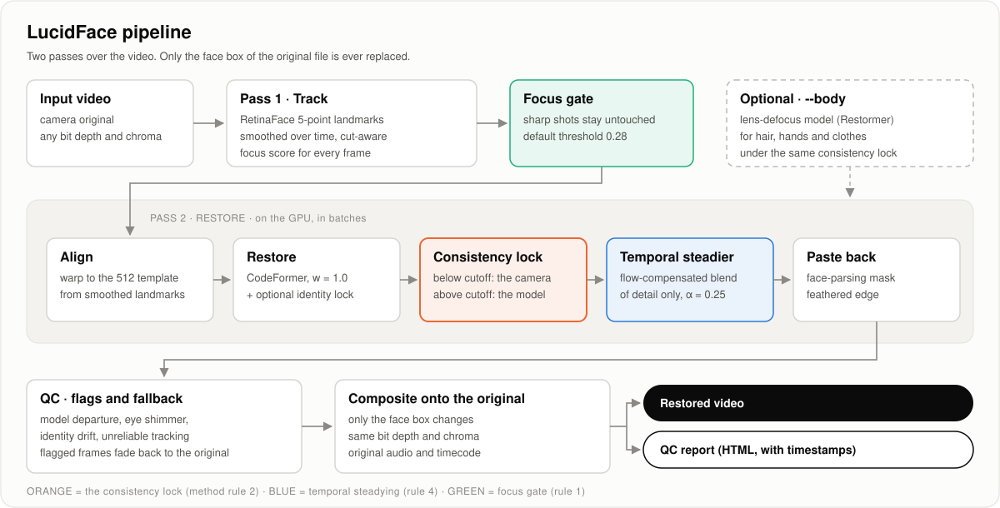
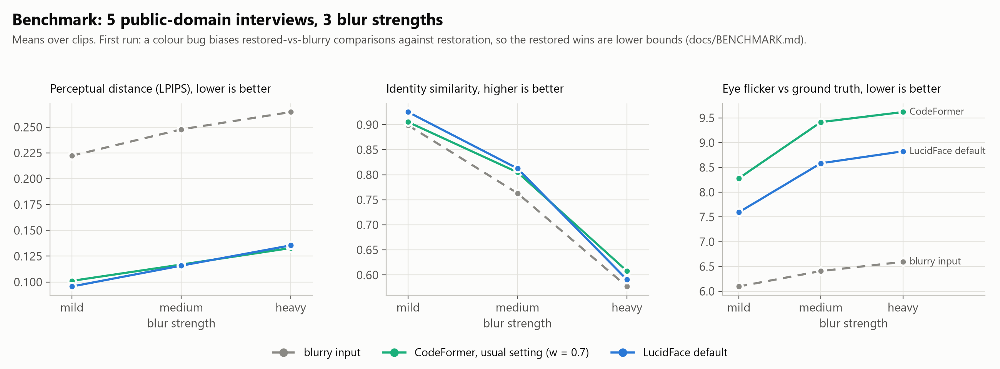
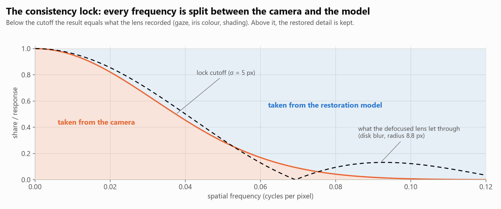
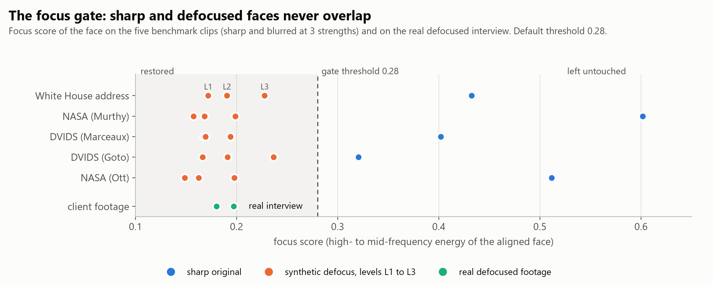
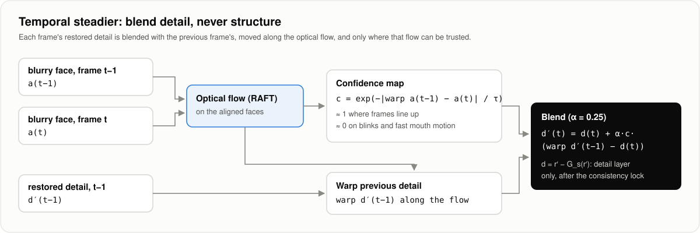
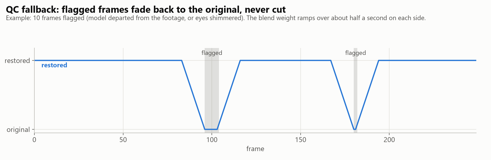
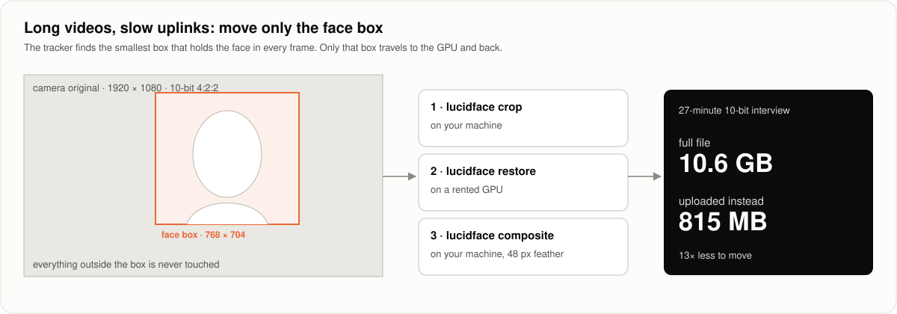

<div align="center">

# LucidFace

**Observation-locked restoration of out-of-focus faces in interview video**

[Technical report](paper/report.md) · [Method](docs/METHOD.md) · [Benchmark](docs/BENCHMARK.md) · [Roadmap](docs/ROADMAP.md)

   

</div>

The camera focused on the wall instead of the person. The whole take is soft, and it cannot be
re-shot. LucidFace rebuilds the face (eyes, lashes, brows, lips, skin) under one rule: **the
restoration may add only what the camera could not record.** Where the person is looking, the colour
of their eyes and how the face is lit come from the footage itself. Everything outside the face box
is the untouched original file.



## Highlights

- **Consistency lock.** Below a cutoff frequency the restored face equals the camera's own frame; above
  it, the model supplies detail. The model cannot move the gaze or recolour an iris. Closed-form,
  works with any face model.
- **Detail-only temporal steadying.** Restored detail is blended along optical flow, and switched off
  wherever the flow is unreliable, so blinks and speech are never ghosted.
- **Focus gate.** In-focus shots are detected and left alone; face models degrade faces that are
  already sharp.
- **Eye-centred QC.** Frames where the model departed from the footage, eyes shimmer or identity
  drifts are flagged, faded back to the original, and listed with timestamps in an HTML report.
- **Production-safe.** Upload only the face box (10.6 GB → 815 MB on a 27-minute 10-bit file), GPU end
  to end, and composite back at the source bit depth with original audio and timecode.
- **Reproducible benchmark** on public-domain interviews, with every number and figure regenerable.

## Results at a glance



| blur | method | LPIPS ↓ | identity ↑ | eye flicker ↓ |
|---|---|---|---|---|
| mild | blurry input | 0.222 | 0.899 | 6.10 |
| mild | **LucidFace** | **0.096** | **0.925** | 7.59 |
| medium | blurry input | 0.248 | 0.763 | 6.41 |
| medium | **LucidFace** | **0.116** | **0.813** | 8.58 |
| heavy | blurry input | 0.265 | 0.577 | 6.59 |
| heavy | **LucidFace** | **0.135** | **0.591** | 8.82 |

Five public-domain interviews, lens blur at three strengths, scored against the sharp originals.
Perceptual distance roughly halves and identity rises (LPIPS better in 15 of 15 cases, identity in
13 of 15). **Honest notes:** this run had a colour bug that biases these comparisons *against*
restoration, so the wins are lower bounds; the consistency lock does not improve averaged scores on
synthetic blur (it exists for a failure seen on real footage); and restored faces still flicker more
than the blurry input. Full tables, ablations and what did not work: [docs/BENCHMARK.md](docs/BENCHMARK.md)
and the [technical report](paper/report.md).

## Method

**The consistency lock.** A defocused lens keeps the low frequencies of the face and destroys the
high ones. LucidFace keeps the camera's low band and the model's high band:
`r' = r + G_s * (a - r)`, with the cutoff `s` tied to the eye distance.



**The focus gate.** A scale-free focus score separates sharp from defocused faces with a clear gap;
only shots below the threshold are restored.



**The temporal steadier.**



**QC fallback.** Flagged frames fade back to the original; there are no hard cuts.



The five rules behind these choices, with the evidence for each: [docs/METHOD.md](docs/METHOD.md).

## Installation

```bash
git clone https://github.com/ironmark72/lucidface && cd lucidface
bash scripts/pod_setup.sh ~/models      # installs LucidFace, fetches CodeFormer and Restormer
export LUCIDFACE_CODEFORMER_DIR=~/models/CodeFormer
```

Requirements: a CUDA GPU with 16 GB or more, Python 3.10+, PyTorch 2.1+, ffmpeg. LucidFace ships no
model weights; `pod_setup.sh` downloads them from their official releases.

## Usage

```bash
lucidface run interview.mp4 -o interview_fixed.mov
```

You get `interview_fixed.mov` and `interview_fixed.qc.html`. Open the report first.

**Long videos, slow uplinks:** move only the face box.



```bash
lucidface crop interview.mov -o face.mp4 --box-out box.json --stride 25     # your machine
lucidface restore face.mp4 -o face_restored.mp4                                # GPU machine
lucidface composite interview.mov face_restored.mp4 -o interview_fixed.mov \
    --box box.json --qc face_restored.qc.npz                                   # your machine
```

| option | default | what it does |
|---|---|---|
| `--backend` | codeformer | `codeformer`, `gfpgan`, or `passthrough` (pipeline test) |
| `--fidelity` | 1.0 | CodeFormer `w`. Keep 1.0: lower values invent more |
| `--lock` | 0.066 | consistency-lock cutoff, as a fraction of the eye distance. `0` turns it off |
| `--steady` | 0.25 | temporal blend strength. `0` turns it off. Higher means less shimmer and softer motion |
| `--gate` | auto | restore only out-of-focus shots (threshold 0.28), a number, or `off` |
| `--reference a.jpg b.jpg` | | sharp photos of the person: identity lock and identity QC |
| `--body` | off | also deblur hair, hands and clothes (slow, about 1 fps) |

Speed: about 10 fps at 1080p with the defaults on an RTX 4080 SUPER, everything included.

## Reproduce the benchmark and figures

```bash
lucidface bench download --dir bench     # five public-domain clips, hashes recorded
lucidface bench run --dir bench          # degrade, restore, score -> bench/results.md
python scripts/make_figures.py           # regenerate the charts in assets/ from docs/data/
python scripts/headtohead.py bench       # compare against KEEP, PGTFormer, SVFR and Topaz exports
```

## Limitations

- A face model reconstructs detail the camera never recorded. The lock removes contradictions with
  the footage; it does not remove invention. **Restored faces are not evidence**; do not use them for
  identification or forensics.
- Synthetic-blur benchmark only, five clips, and no head-to-head against other tools yet.
- The lock cutoff is fixed; estimating each shot's real blur is the top [roadmap](docs/ROADMAP.md) item.
- One face per video; profile views beyond about 60 degrees fall back to the original.

## Licences

The LucidFace code is MIT. The default face model, CodeFormer, is **non-commercial** (S-Lab License
1.0), as are the other strong face models available today. Every component and what its licence
allows is listed in [NOTICE.md](NOTICE.md). Check the models you enable before commercial use.

## Citation

```bibtex
@software{lucidface2026,
  title  = {LucidFace: Observation-Locked Restoration of Out-of-Focus Faces in Interview Video},
  author = {{LucidFace contributors}},
  year   = {2026},
  url    = {https://github.com/ironmark72/lucidface}
}
```

## Acknowledgements

CodeFormer (Zhou et al., 2022) and GFPGAN (Wang et al., 2021) face priors; facexlib (RetinaFace,
ParseNet); Restormer (Zamir et al., 2022); RAFT (Teed and Deng, 2020); facenet-pytorch; LPIPS (Zhang
et al., 2018). The consistency lock is classic back-projection (Irani and Peleg, 1991). Benchmark
footage: US federal government works, in the public domain.
