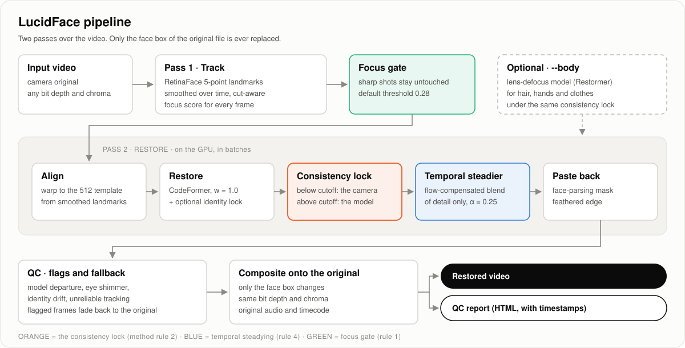

# The LucidFace method



LucidFace restores faces that are **out of focus** in interview and talking-head video: the camera
focused on the wall, the subject is soft for the whole take. It is a method more than a model:
the pieces are existing, credited components, put together around five rules we learned the hard way
on real client footage. Each rule says what we observed, what LucidFace does about it, and how the
effect is measured.

## Rule 1: diagnose the blur before choosing a tool

Defocus is not low resolution. A defocused face at 1080p has plenty of pixels; what it lacks is
high-frequency content, removed by the lens's disk-shaped point-spread function. Video
super-resolution models are trained to undo downscaling and compression, and on defocus they mostly
leave the image as it is.

*What we saw:* on a 27-minute defocused interview, SeedVR2 (3B, 7B and 7B-sharp, with the input
pre-shrunk 1x to 4x) only slightly crisped the eyes. A face prior (CodeFormer) rebuilt the eyes, brows
and lips.

*What LucidFace does:* face-prior restoration for the face, and, optionally, a model trained on real
lens defocus (Restormer, DPDD) for hair, hands and clothes. Pass 1 gives every frame a
scale-independent **focus score** (high- to mid-frequency energy on a 256 px aligned face), and by
default only out-of-focus shots are restored (`--gate auto`), because face priors degrade faces that
are already sharp.

*Calibration (benchmark):* sharp faces score 0.32 to 0.60; defocused faces score 0.15 to 0.24 at
every blur level, and our real defocused footage scored 0.18 to 0.20. The default threshold is 0.28.
Note that the score is not a sharpness meter inside the blurry range: on a blurred, noisy face the
"fine detail" is mostly sensor noise, so the score rises slightly with heavier blur. It separates sharp
from blurry; it does not measure how blurry.

## Rule 2: the camera is the ground truth for everything it can see (the consistency lock)

Face priors invent detail. That is how they work, and also how they fail: on our footage the model
moved the far eye's gaze toward the camera and turned a brown iris grey. Both errors are at **low
spatial frequencies**, and low frequencies are exactly what survives defocus. The blurry frame
therefore still tells us where the iris is, what colour it is, and how the face is lit.

LucidFace keeps only what the camera could not record:

```
r' = r + G_s * (a - r)
```

`a` is the aligned observed face, `r` the model output, and `G_s` a gaussian low-pass whose cutoff
`s` is a fixed fraction of the inter-ocular distance (`--lock 0.066`, so behaviour does not depend on
shot size). Below the cutoff the result equals the observation; above it, the model's detail (lashes,
lid edges, iris texture) is kept. This is one step of classic back-projection (Irani and Peleg, 1991),
the same idea as data-consistency steps in modern restoration (e.g. DDNM, DPS), applied as a
model-agnostic post-step.

*Measured on real footage:* on the defocused interview that motivated LucidFace, the lock fixed the
visible failures (grey iris, gaze pointed at the camera). On two 6-second test clips the eye fidelity
error (re-blurred output vs observation, Lab) went from 2.26 to 1.81, and iris colour error from 4.98
to 3.62 (dE).

*Measured on the synthetic benchmark (honest result):* the lock does **not** improve the averaged
face scores there. With a fixed cutoff it is neutral on mild blur and costs a little identity
similarity on medium and heavy blur (0.819 to 0.811, 0.605 to 0.590). The cause is the cutoff: a lens
blur of radius r keeps detail only up to a frequency proportional to 1/r, and a gaussian with
sigma = 0.53 r matches it at the 50% point. A fixed cutoff is right for one blur level (it was tuned on
footage at about the medium level) and too tight for heavier blur, where it pins some of the blur back
in. Matching the cutoff to the true radius recovers most of it (heavy: 0.590 to 0.599) and makes the
lock a small win on mild blur (identity 0.925 to 0.929), but on medium and heavy blur no lock is still
marginally ahead (by 0.006 to 0.008).

*Why it stays on by default:* the failure it prevents (moved gaze, recoloured eyes) is rare in
averaged scores and glaring to a viewer, and synthetic blur on clean footage did not trigger it the
way real camera defocus did. We trade a little average identity similarity for a guarantee that the
result never contradicts what was filmed. Use `--lock 0` to turn it off. Estimating the blur radius
per shot, so the cutoff always matches, is the first item on the roadmap.

*Choosing the model setting:* use the most faithful setting of the face prior (CodeFormer `w = 1.0`).
On the benchmark it beats the common default `w = 0.7` on identity similarity in 11 of 15
clip-and-level cases (mild: 0.925 vs 0.905, medium: 0.819 vs 0.805), with equal or better
perceptual distance.

## Rule 3: judge eyes by eyes

Viewers look at eyes first, and whole-face metrics hide eye failures. LucidFace's QC and benchmark
report eye-specific numbers:

- **eye departure:** re-blur the restored eye region with the estimated defocus and compare it with the
  observed eye. No reference is needed, so this works on real footage. It catches moved gaze and
  changed iris colour.
- **iris colour error:** Lab distance of the darkest quarter of the eye box.
- **eye flicker:** frame-to-frame change of the restored eyes, compared with the original's own eye
  motion.

In our model comparison these numbers put the options in the same order a person did:
RestoreFormer turned irises blue, GFPGAN gave "doll eyes", and CodeFormer 0.7 greyed the far eye.

## Rule 4: steady the face before and after the model

Per-frame restoration shimmers. Two sources, two fixes:

1. **Alignment jitter.** Landmarks jump by a pixel or two per frame, so the face is re-aligned
   differently each time and the model's detail moves with it. Pass 1 smooths landmarks over time (a
   gaussian over about 5 frames), fills short detection gaps, and never smooths across a cut.
2. **Detail flicker.** Pass 2 blends each frame's detail layer `d = r' - G_s(r')` with the previous
   frame's, motion-compensated by optical flow (RAFT-small), and only where the flow is trustworthy
   (`conf = exp(-|warp(a_t-1) - a_t| / tau)`). Blinks and fast mouth movement get confidence near
   zero, so they are never ghosted. Only the detail layer is blended: low frequencies stay locked to
   the observation, so motion is never lagged.

*Measured:* `--steady 0.25` lowered the eye flicker error against ground truth on all 15
clip-and-level cases (mild: 8.12 to 7.59, heavy: 9.51 to 8.82) and slightly raised eye PSNR.
`--steady 0.5` lowers it further (7.18) and still scores well on the benchmark, but on real footage
with fast head turns it visibly softened the face, because optical flow on blurry faces is not precise
enough there. The default is 0.25. Even so, every restoration flickers more than the blurry input does
(6.1 to 6.6): restored detail is not perfectly stable. That is the second roadmap item.

## Rule 5: a person signs off, and the tool makes that fast

No automatic metric replaces a person looking at the result, so LucidFace makes the look quick:

- **Flags:** frames where the model departed strongly from what was filmed, where eyes shimmer, where
  identity drifts from the reference photos, or where tracking is unreliable.
- **Fallback:** flagged frames fade back to the original over a short ramp; there are no hard switches.
- **Report:** an HTML page with timelines, flagged ranges as timestamps, and before/after thumbnails.
- **Reference lock (optional):** with sharp photos of the person, each frame is restored several ways
  and the candidate closest to the reference identity is kept, with hysteresis so the choice does not
  flicker.

## Production details that matter

- **Upload only the face region.** `lucidface crop` finds the smallest box that holds the face in every
  frame. On our 27-minute 10-bit file this was 815 MB instead of 10.6 GB.
- **Composite onto the original.** Only that box is replaced, with a feathered edge. Everything else is
  the untouched camera original, at the source bit depth (10-bit 4:2:2 stays 10-bit 4:2:2), with the
  original audio and timecode.
- **GPU end to end.** Alignment, the lock, the temporal blend and paste-back are torch operations on
  the GPU. The reference script used the CPU for these and capped at 1.4 fps per worker.
- **Never trust the colour matrix.** Piping RGB frames into an encoder without naming the matrix
  makes ffmpeg use BT.601 while the file is tagged BT.709, so every player shows shifted colours. On
  our client footage this tinted the restored face box by up to 3.7 levels in blue, a faint rectangle
  on a flat wall. LucidFace names the matrix and uses accurate rounding on every read and write, and a
  test (`test_video_roundtrip_has_no_colour_bias`) fails if a round trip drifts by more than 0.3 levels.
  When compositing, measure the colour of the wall inside the replaced box against the original: it
  should match to well under one level.

## Limits

- Hair, hands and clothes need `--body`, which is slow (about 0.3 to 1 s per frame).
- The face prior can still invent features the camera never captured (moles, exact eye shape). The
  reference lock reduces this, it does not remove it. Always check the report.
- Profile views beyond about 60 degrees and heavily occluded faces fall back to the original.
- Licences: the best face prior (CodeFormer) is **non-commercial**. See NOTICE.md.
