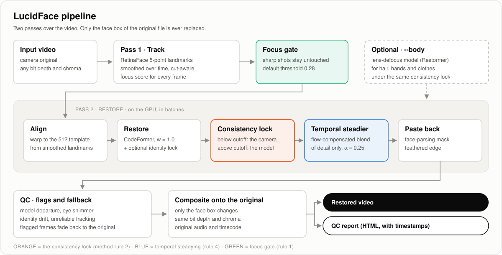
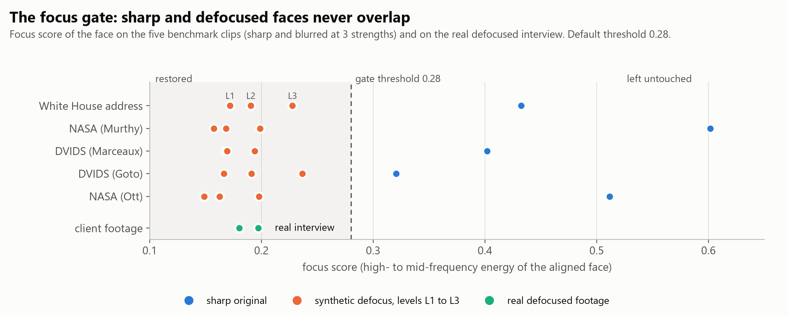
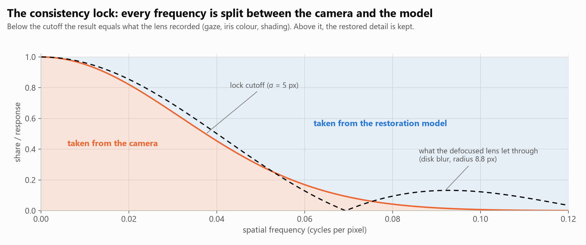
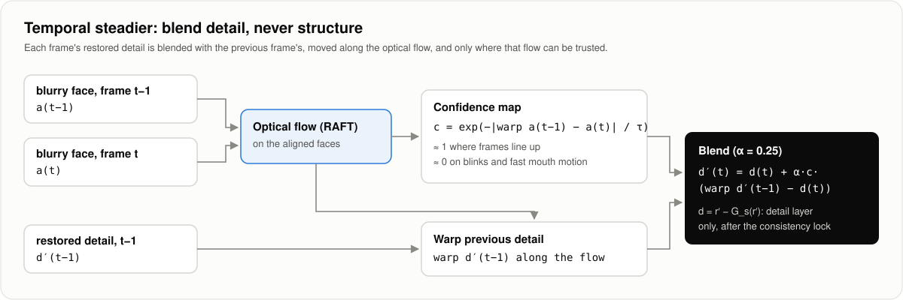
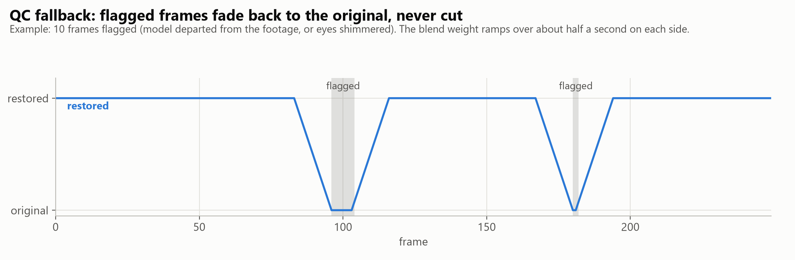
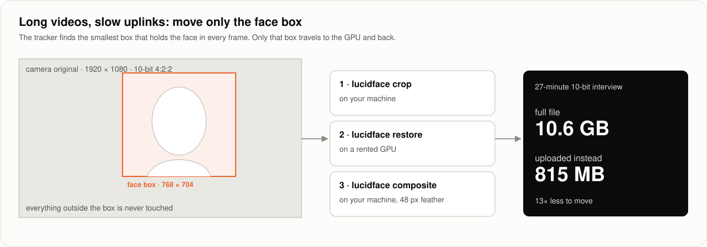
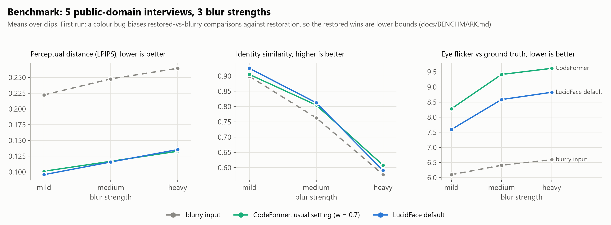

# LucidFace: Observation-Locked Restoration of Out-of-Focus Faces in Interview Video

*Technical report, November 2026. LucidFace contributors.*
*Code, data and figures: https://github.com/ironmark72/lucidface*

---

## Abstract

Interview footage in which the camera focused on the background instead of the speaker is common and
usually unusable. Generic video super-resolution does not fix it: lens defocus removes high
frequencies from a face that is already well sampled. Face priors such as CodeFormer rebuild a
convincing face, but they also invent details the camera did contain, for example the direction of
the gaze or the colour of the iris. We describe **LucidFace**, a method and an open pipeline built
around one rule: *the restoration may add only what the camera could not record*. A low-frequency
**consistency lock** pins the restored face to the observed frame below a cutoff tied to the eye
distance, a **temporal steadier** blends only the detail layer along trustworthy optical flow, a
**focus gate** leaves in-focus shots untouched, and an eye-centred **QC** stage flags and fades out
doubtful frames. On a reproducible benchmark of five public-domain interviews with synthetic lens
blur at three strengths, LucidFace halves perceptual distance to the sharp original (LPIPS 0.222 to
0.096 on mild blur), raises identity similarity in 13 of 15 clip-and-level cases, and lowers eye
flicker against the ground truth in all 15 cases relative to the unsteadied pipeline. We also report
what did not work: the consistency lock does not improve averaged scores on synthetic blur, and every
restoration still flickers more than the blurry input.

---

## 1. Introduction

A missed focus pull leaves the background sharp and the person soft for the entire take. In
interviews this is often discovered only in the edit, when re-shooting is impossible. The face is
what viewers look at, and the eyes most of all, so the bar is specific: the face must look sharp,
the person must stay recognisably themselves, and nothing may contradict the footage, least of all
where they are looking.

Two families of tools are available. **Video super-resolution** (SeedVR2 [11], FlashVSR [12],
commercial upscalers) undoes downscaling and compression. On defocus it does little, because the
frame is not under-sampled; it is low-passed by the lens. In our tests SeedVR2 at 3B and 7B, with the
input pre-shrunk by 1x to 4x, only slightly crisped the eyes of a 27-minute defocused interview.
**Face priors** (CodeFormer [1], GFPGAN [2], RestoreFormer [3]) rebuild a face from a learned
dictionary. They solve the sharpness problem and create the fidelity problem: on the same interview
CodeFormer at its common setting turned one brown iris grey and pointed that eye at the camera
while the other eye looked away.

LucidFace is the method we arrived at by fixing those failures one at a time. Our contributions:

1. A **consistency lock**: a model-agnostic, closed-form post-step that makes the restored face
   equal to the observation below a cutoff frequency, so gaze, iris colour and shading cannot be
   rewritten (Section 3.3).
2. A **detail-only temporal steadier** with a flow-confidence gate (Section 3.4).
3. A **focus gate**, calibrated so sharp and defocused faces do not overlap (Section 3.2).
4. **Eye-centred evaluation**: no-reference metrics usable on real footage (re-blurred eye
   departure, iris colour error, eye flicker), and a reference benchmark built only from
   public-domain video (Section 4).
5. A **production pipeline**: crop-only transfer, GPU end-to-end, and a lossless composite onto the
   original file with bit depth, audio and timecode preserved (Section 3.6).

---

## 2. Related work

**Blind face restoration.** GFPGAN [2] uses a generative facial prior; RestoreFormer [3] and
CodeFormer [1] use learned codebooks, CodeFormer with a fidelity weight $w$ trading quality for
faithfulness. These models work on single 512 px aligned faces and are the default backends of
LucidFace. All are trained on FFHQ with synthetic degradations.

**Video face restoration.** KEEP [5] and PGTFormer [6] add temporal propagation for consistent
faces across frames; SVFR [7] builds a unified restorer on Stable Video Diffusion. Reference-guided
methods (InstantRestore [8], DMDNet [9], RestorerID, IP-FVR [10]) use photos of the same person to
preserve identity. At the time of writing every one of these ships weights for non-commercial use
only, as does CodeFormer.

**Defocus deblurring.** Real-defocus datasets (DPDD [13], RealDOF, LFDOF) support single-image
models such as Restormer [14], NRKNet, LaKDNet and IFAN. They act on the whole frame, have no face
prior, and on faces produce gains far smaller than face priors. LucidFace uses Restormer only for
hair, hands and clothes, under the same lock.

**Data consistency.** Forcing a reconstruction to agree with the observation is old: iterative
back-projection [15] for super-resolution, and range-null-space or posterior-sampling steps in
diffusion restoration (DDNM [16], DPS [17]). The consistency lock is a single back-projection step
with a gaussian approximation of the blur, applied after an arbitrary restorer.

**Commercial tools.** Topaz Video AI's Iris model targets faces in low-to-medium quality video and
offers a "Recover Original Detail" control that blends source texture back in [18], a related idea
applied in the opposite direction. Vendor material and user reports describe it as aimed at noisy,
compressed or interlaced footage; we have not yet benchmarked it (Section 6).

---

## 3. Method

### 3.1 Tracking (pass 1)

RetinaFace [19] gives five landmarks per frame on a copy with the short side at 640 px. One identity
is tracked by position. Gaps of up to six frames are filled linearly. Landmarks are smoothed with a
gaussian over time ($\sigma = 2$ frames), restarted at cuts, which are detected as a jump larger than
0.6 of the inter-ocular distance (IOD). Smoothing lags behind fast head turns, so where the smoothed
track deviates from the measurement by more than 4% of the IOD the track blends back towards the
measurement (fully at 12%). The result is a per-frame alignment that does not jitter when the head is
still and does not lag when it moves.

### 3.2 Focus gate

On a 256 px aligned crop of the inner face, the **focus score** is the ratio of high-frequency to
mid-frequency energy:

$$\phi = \frac{\operatorname{mean}|g - G_1 g|}{\operatorname{mean}|G_1 g - G_4 g|}$$

where $G_\sigma$ is a gaussian blur. It is scale-free by construction. Only shots whose median score
over one second is below a threshold are restored, with hysteresis and a one-second minimum segment.

On the benchmark, sharp faces score 0.32 to 0.60 and defocused faces 0.15 to 0.24 at every blur
level, as does the real defocused interview (0.18 to 0.20). The default threshold is 0.28. The score
separates sharp from blurry, but it does not measure *how* blurry: on a blurred, noisy face the high
band is mostly sensor noise, and the score rises slightly with heavier blur.

### 3.3 Restoration and the consistency lock (pass 2)

Each tracked face is warped to the FFHQ 5-point template at 512 px, giving the observation $a$. The
backend (CodeFormer at $w = 1.0$ by default) returns $r$. The **consistency lock** replaces the low
frequencies of $r$ with those of $a$:

$$r' = r + G_s * (a - r), \qquad s = \lambda \cdot \mathrm{IOD}_{512}, \quad \lambda = 0.066$$

Below the cutoff, $r'$ equals the observation; above it, $r'$ keeps the model's detail. Because a
defocused lens keeps exactly the low band, the lock makes the result agree with everything the camera
did capture, which includes iris position and colour, gaze and shading, while leaving lashes, lid
edges and iris texture to the model.

The cutoff matters. A lens blur of radius $\rho$ has the response $|2J_1(2\pi\rho f)/(2\pi\rho f)|$,
whose 50% point matches a gaussian of $\sigma \approx 0.53\rho$. The default $\lambda$ was tuned on
real footage whose blur sits at our "medium" level, where it matches. For heavier blur it is too tight
and pins some of the blur back in (Section 5.3).

**Identity lock (optional).** With reference photos, each frame is restored at several fidelities
($w \in \{1.0, 0.8, 0.6\}$), each locked, and the candidate whose face embedding (facenet [20]) is
closest to the reference mean is kept. The choice is smoothed with an exponential moving average and
switches only past a margin of 0.01, so it does not flicker.

### 3.4 Temporal steadier

The restored detail layer $d = r' - G_s r'$ of frame $t$ is blended with the previous frame's,
warped along optical flow (RAFT-small [21]) computed between the aligned observations:

$$d'_t = d_t + \alpha\, c_t \odot \big(\mathcal{W}(d'_{t-1}) - d_t\big), \qquad
c_t = \exp\!\Big(-\frac{G_3 |\mathcal{W}(a_{t-1}) - a_t|}{\tau}\Big)$$

with $\alpha = 0.25$ and $\tau = 0.035$. The confidence $c$ drops to zero on blinks and fast mouth
motion, so they are never ghosted. Only detail is blended; low frequencies stay locked to the current
frame, so motion is never lagged. Cuts and missing faces reset the state.

### 3.5 Paste-back and QC

The face is warped back with a face-parsing mask (ParseNet [22]: skin, brows, eyes, nose, lips; not
hair or neck), feathered. All warps are batched `grid_sample` calls on the GPU. Per frame, QC records
how far the model departed from the observation before the lock (re-blurred difference inside the
mask), the same on the eyes, eye flicker against the input's own eye motion, identity similarity when
references exist, and tracking deviation. A flag requires two of three consecutive frames; flagged
frames fade back to the original over about half a second.

### 3.6 Production details

- **Crop-only transfer.** The smallest box containing every aligned face, plus margin, is all that
  needs to reach the GPU. On a 27-minute 10-bit interview that was 815 MB instead of 10.6 GB.
- **Lossless composite.** Only that box is replaced in the original file, with a 48 px feather. Bit
  depth and chroma are preserved (10-bit 4:2:2 stays 10-bit 4:2:2), and audio and timecode are copied.
- **Colour matrices.** Piping RGB into an encoder without naming the matrix makes ffmpeg use BT.601
  while tagging BT.709. On our client file this tinted the face box by up to 3.7 levels (8-bit) in
  blue. LucidFace names the matrix and rounds accurately on every read and write; a test fails if a
  round trip drifts by more than 0.3 levels.

---

## 4. Benchmark

**Footage.** Five interview segments, all US federal government works and therefore in the public
domain (a White House address, two NASA Goddard interviews, two DVIDS interviews): three men and two
women, several skin tones, close-ups and medium shots, one subject with glasses and one wearing a
cap. Windows (10 to 20 s) were chosen by a 1 fps face scan so that exactly one large face is on screen
throughout. Sources and SHA-256 hashes are in `docs/BENCHMARK.md`.

**Degradation.** A disk PSF of radius 8%, 12% or 16% of the subject's IOD (levels 1 to 3, so a level
means the same blur on any shot size), gaussian noise ($\sigma = 1.5$), and an H.264 re-encode (CRF 20).

**Protocol.** Methods track faces on the blurry input. Scoring uses the sharp ground truth's
landmarks, in its aligned 512 px face space, inside its parsing mask: PSNR and LPIPS [23] on the
face, PSNR on the two eye boxes, identity cosine (facenet), and the temporal error
$|(o_t - o_{t-1}) - (g_t - g_{t-1})|$ on the eyes.

**Caveat.** The run reported here had the colour-matrix bug of Section 3.6. All restored outputs carry
the same small shift, so comparisons between restored configurations are valid; comparisons with the
blurry input are biased against restoration, so restored wins are lower bounds. Data:
`docs/data/results_run1*.csv`.

---

## 5. Results

### 5.1 Restoration versus the blurry input

| blur | method | LPIPS ↓ | identity ↑ | eye flicker ↓ | fps |
|---|---|---|---|---|---|
| mild | blurry input | 0.222 | 0.899 | 6.10 | |
| mild | CodeFormer, w = 0.7 | 0.101 | 0.905 | 8.28 | 12.2 |
| mild | **LucidFace** | **0.096** | **0.925** | 7.59 | 9.9 |
| medium | blurry input | 0.248 | 0.763 | 6.41 | |
| medium | CodeFormer, w = 0.7 | 0.117 | 0.805 | 9.41 | 12.2 |
| medium | **LucidFace** | **0.116** | **0.813** | 8.58 | 9.9 |
| heavy | blurry input | 0.265 | 0.577 | 6.59 | |
| heavy | CodeFormer, w = 0.7 | 0.133 | **0.608** | 9.62 | 12.1 |
| heavy | LucidFace | 0.135 | 0.591 | 8.82 | 9.9 |

Perceptual distance roughly halves at every level and identity rises; per case, LucidFace beats the
blurry input on LPIPS in 15 of 15 and on identity in 13 of 15. Speed is end to end on an RTX 4080
SUPER at 1080p.

### 5.2 Ablations

| finding | cases |
|---|---|
| CodeFormer $w = 1.0$ beats $w = 0.7$ on identity | 11 of 15 (exceptions all medium or heavy) |
| steadier ($\alpha = 0.25$) lowers eye flicker vs ground truth | 15 of 15 |
| matched lock ($\sigma = 0.53\rho$) beats the fixed lock on identity | 10 of 15 |
| matched lock beats no lock on identity | 9 of 15 |

$\alpha = 0.5$ lowers flicker further on the benchmark (mild: 7.18) but visibly softened the face
on real footage with fast head turns, so 0.25 is the default.

### 5.3 What did not work

**The lock does not improve averaged scores on synthetic blur.** With the fixed cutoff, identity is
0.924 / 0.811 / 0.590 (mild / medium / heavy) versus 0.925 / 0.819 / 0.605 without it. Matching the
cutoff to the true blur radius recovers most of the gap and is the best setting on mild blur (0.930
with steadying), but no lock is still ahead on medium and heavy blur by 0.006 to 0.008. The failure
the lock was built for (rewritten gaze and iris colour) appeared on real camera defocus and was not
triggered by synthetic disk blur on clean footage, so the benchmark cannot show its value. We keep it
on by default as a guarantee and expose `--lock 0`.

**Restoration adds flicker.** Every restored configuration flickers more against the ground truth
than the blurry input does (7.6 to 9.6 vs 6.1 to 6.6). The steadier reduces it but does not close the
gap.

### 5.4 Optional features (single clip, indicative)

The identity lock with one sharp frame from another minute of the same video raised identity from
0.854 to 0.867 at 4.4 fps. The body deblur added 0.15 dB on the hair-and-clothes region at 0.95 fps,
a small gain for a large cost.

---

## 6. Limitations and future work

- **Benchmark scope.** Five clips, synthetic disk blur, one run with a known colour bias, and no
  comparison yet against KEEP, PGTFormer, SVFR or Topaz Iris. The head-to-head runner is in
  `scripts/headtohead.py`.
- **Blur estimation.** The lock needs the blur radius to set its cutoff; the focus score cannot
  provide it. Estimating the PSF per shot is the top roadmap item.
- **Licences.** The best face priors are non-commercial; a commercially clean default needs a prior
  trained on permissively licensed data.
- **Invention.** A face prior reconstructs detail the camera did not record. The lock removes
  contradictions with the footage, not invention; restored faces are not evidence and must not be
  used for identification.

---

## 7. Conclusion

Out-of-focus interview footage is a face problem, not a resolution problem, and the main risk in
fixing it is a face that looks sharp and wrong. LucidFace treats the blurry frame as ground truth
for everything it still contains and lets a face prior supply only the rest, steadies the result over
time, leaves sharp shots alone, and makes doubtful frames easy to find. The method, code, benchmark
and every number in this report are public and reproducible.

---

## References

1. S. Zhou, K. Chan, C. Li, C. C. Loy. Towards Robust Blind Face Restoration with Codebook Lookup Transformer (CodeFormer). NeurIPS 2022.
2. X. Wang, Y. Li, H. Zhang, Y. Shan. Towards Real-World Blind Face Restoration with Generative Facial Prior (GFPGAN). CVPR 2021.
3. Z. Wang et al. RestoreFormer: High-Quality Blind Face Restoration from Undegraded Key-Value Pairs. CVPR 2022.
4. T. Karras, S. Laine, T. Aila. A Style-Based Generator Architecture for Generative Adversarial Networks (FFHQ). CVPR 2019.
5. R. Feng, C. Li, C. C. Loy. Kalman-Inspired Feature Propagation for Video Face Super-Resolution (KEEP). ECCV 2024.
6. K. Xu et al. Beyond Alignment: Blind Video Face Restoration via Parsing-Guided Temporal-Coherent Transformer (PGTFormer). IJCAI 2024.
7. Z. Wang et al. SVFR: A Unified Framework for Generalized Video Face Restoration. CVPR 2025.
8. InstantRestore: Single-Step Personalized Face Restoration with Shared-Image Attention. arXiv 2412.06753, 2024.
9. X. Li et al. Learning Dual Memory Dictionaries for Blind Face Restoration (DMDNet). TPAMI 2022.
10. IP-FVR: reference-guided identity preservation in face video restoration. arXiv 2507.10293, 2025.
11. J. Wang et al. SeedVR2: One-Step Video Restoration via Diffusion Adversarial Post-Training. ICLR 2026.
12. FlashVSR: Towards Real-Time Diffusion-Based Streaming Video Super-Resolution. 2025.
13. A. Abuolaim, M. S. Brown. Defocus Deblurring Using Dual-Pixel Data (DPDD). ECCV 2020.
14. S. W. Zamir et al. Restormer: Efficient Transformer for High-Resolution Image Restoration. CVPR 2022.
15. M. Irani, S. Peleg. Improving Resolution by Image Registration. CVGIP: Graphical Models and Image Processing, 1991.
16. Y. Wang, J. Yu, J. Zhang. Zero-Shot Image Restoration Using Denoising Diffusion Null-Space Model (DDNM). ICLR 2023.
17. H. Chung et al. Diffusion Posterior Sampling for General Noisy Inverse Problems (DPS). ICLR 2023.
18. Topaz Labs. Topaz Video: enhancement filters, Iris model. docs.topazlabs.com, accessed November 2026.
19. J. Deng et al. RetinaFace: Single-Shot Multi-Level Face Localisation in the Wild. CVPR 2020.
20. F. Schroff, D. Kalenichenko, J. Philbin. FaceNet: A Unified Embedding for Face Recognition and Clustering. CVPR 2015.
21. Z. Teed, J. Deng. RAFT: Recurrent All-Pairs Field Transforms for Optical Flow. ECCV 2020.
22. Face parsing network (ParseNet) as distributed in facexlib (X. Wang, 2021).
23. R. Zhang et al. The Unreasonable Effectiveness of Deep Features as a Perceptual Metric (LPIPS). CVPR 2018.
